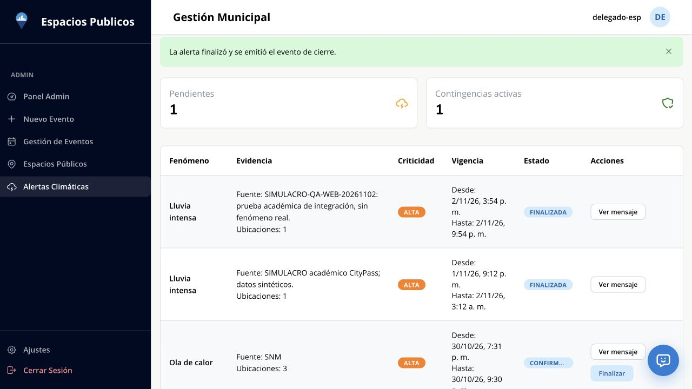

# Prueba desde la web de Espacios Públicos — 02/11/2026

## Resultado

Se creó, confirmó y finalizó una alerta nueva desde la web desplegada de Espacios
Públicos. La web informó éxito en ambas acciones, pero no se observaron publicaciones
nuevas en los dos tópicos climáticos de EDA. Residuos no recibió esta alerta ni creó
una contingencia para ella. **La prueba entre equipos sigue bloqueada en la entrega
desde Espacios Públicos hacia el bus.**

El acceso a EDA ya funciona desde esta red: OAuth, catálogo y Kafka/TLS se comprobaron
con la identidad de servicio de Residuos. El consumidor local mostró **Kafka conectado**.
El [flujo de Residuos publicado directamente en EDA](prueba-eda-real-2026-11-02.md)
permanece completado y sus datos se conservaron.

## Alerta utilizada

- Aplicación: `https://espacios-publicos-frontend.vercel.app/admin/weather-alerts`.
- Identificador del ejercicio: `SIMULACRO-QA-WEB-20261102`.
- `alertaId`: `9cb579b4-297f-4b3d-bbd6-6e8e04d501d9`.
- Fenómeno: `LLUVIA_INTENSA`; criticidad: `ALTA`; barrio: `SAN NICOLAS`.
- Punto: latitud `-34.603666`, longitud `-58.380515`.
- Actor: `U000009`.
- Inicio de vigencia: `2026-11-02T18:54:00.000Z` (15:54, Argentina).
- Fin estimado: `2026-11-03T00:54:00.000Z` (02/11, 21:54, Argentina).
- Confirmación persistida: `2026-11-02T18:56:37.100Z` (15:56:37, Argentina).
- Finalización mostrada en su payload: `1793646216355`, equivalente a
  `2026-11-02T19:03:36.355Z` (16:03:36, Argentina).

Motivo y fuente identificaron explícitamente un **SIMULACRO académico con datos
sintéticos y sin fenómeno real**. Esos textos son evidencia interna de Espacios
Públicos; no forman parte del payload climático enviado al gateway.

Se usó **Crear alerta manual → Guardar como pendiente → Confirmar y publicar →
Finalizar**. Se verificó el mismo `alertaId` en los payloads de inicio y cierre.
No se modificaron las demás alertas de Espacios Públicos.

## Comprobación de entrega

El catálogo resolvió los nombres y tópicos reales, schemas 28 y 27, versión 1.
El diagnóstico de Kafka consultó solamente contadores de esos dos tópicos: no
consumió ni guardó históricos de otros equipos ni cambió offsets del consumidor.

| Tópico, partición 0 | Low | High tras confirmar, 16:02:46 AR | High tras finalizar, 16:04:15 AR |
| --- | --- | --- | --- |
| `com.citypass.espacios.CriticidadClimaticaConfirmada` | 0 | 1 | 1 |
| `com.citypass.espacios.CriticidadClimaticaFinalizada` | 0 | 1 | 1 |

Esos registros únicos son los históricos que ya se habían recibido. La consulta
local por el identificador nuevo devolvió cero alertas, cero contingencias y cero
respuestas climáticas en el outbox. La vista de recepción tampoco mostró el ID nuevo.

Se consultó además el detalle oficial de **esta alerta únicamente**, con la cuenta
de prueba de Espacios Públicos: confirmó `status=CONFIRMED` y la fecha de confirmación.
Su evidencia no incluyó `publicationChannel`; esto no permite identificar el driver
efectivo ni la versión desplegada. El cierre posterior se verificó en la web.

Estos resultados ubican el bloqueo antes de la recepción en Residuos, pero no
demuestran su causa exacta. En el repositorio revisado, `EVENT_BUS_DRIVER` tiene
`console` como valor por defecto; ese adaptador también devuelve éxito. Deben
comprobarse la configuración efectiva, el destino y los resultados HTTP del Outbox
del backend desplegado. No se accedió a su configuración privada ni se modificó su
servidor. Ver [revisión del productor](revision-espacios-publicos-2026-11-02.md).

La [evidencia estructurada](../evidencias/espacios-web-2026-11-02.json) conserva
identificadores, contadores y estados locales, sin credenciales.

## Datos locales preparados

Se agregaron dos contenedores nuevos en Centro, conservando el ensayo anterior:

| Recurso | Estado al finalizar esta comprobación |
| --- | --- |
| `QA-WEB-01`, Centro | CRITICO, 90 %, parada pendiente |
| `QA-WEB-02`, Centro | NORMAL, 30 %, preparado para comprobar la recuperación no crítica |
| `QA-EDA-03`, Norte | CRITICO, 85 %, control fuera de Centro |
| Ruta inicial | `21ca5029-587e-49e2-881f-ef0a7c62bb52`, ASIGNADA |
| Camión y chofer | `QA021126` y `QA-EDA-1102` |

Frontend local en `http://localhost:5173`, API en `http://127.0.0.1:3038/api/v1` y
base aislada `residuos_integracion_real_demo`. El delegado conserva rol OPERADOR.
El simulador HTTP climático permanece apagado. No se vaciaron contenedores ni se
forzaron estados de suspensión para reemplazar el mensaje faltante.

Cuando Espacios Públicos confirme su envío real, conviene crear una alerta con ID
nuevo y mantenerla activa hasta observar la suspensión. Esta alerta ya tiene cierre;
reenviar ambos mensajes juntos no permite observar primero una contingencia activa.

No hubo cambios en el código de aplicación en esta ejecución. No se repitieron las
suites; la validación anterior conserva 556 unitarios backend, 379 frontend y 112 E2E.

## Mensaje para Espacios Públicos

Probamos nuevamente el 02/11 desde tu web: creamos y confirmamos a las 15:56:37 AR
el simulacro `9cb579b4-297f-4b3d-bbd6-6e8e04d501d9` (lluvia intensa, ALTA, San Nicolás)
y lo finalizamos a las 16:03:36. La web informó éxito en ambos pasos, pero los tópicos
de Confirmada y Finalizada siguen con high offset 1, sin registros nuevos. Nuestro
consumidor está conectado y el flujo completo con nuestros propios eventos en EDA
ya funcionó. ¿Podés revisar el Outbox de esa alerta y confirmar que el backend
desplegado usa `EVENT_BUS_DRIVER=citypass`, apunta al gateway de test y qué HTTP
devolvió cada publicación? En el repo, el driver `console` también informa éxito.
No hacen falta secretos. Cuando esté corregido repetimos con una alerta nueva y
la mantenemos activa mientras verificamos la suspensión.
